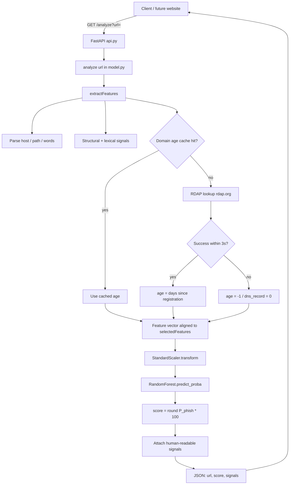
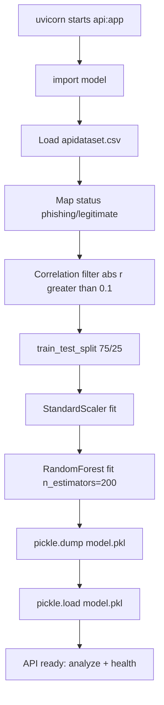
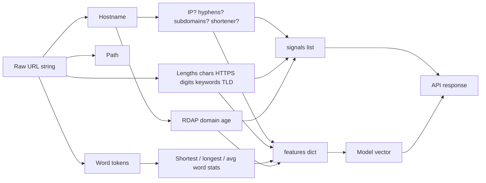
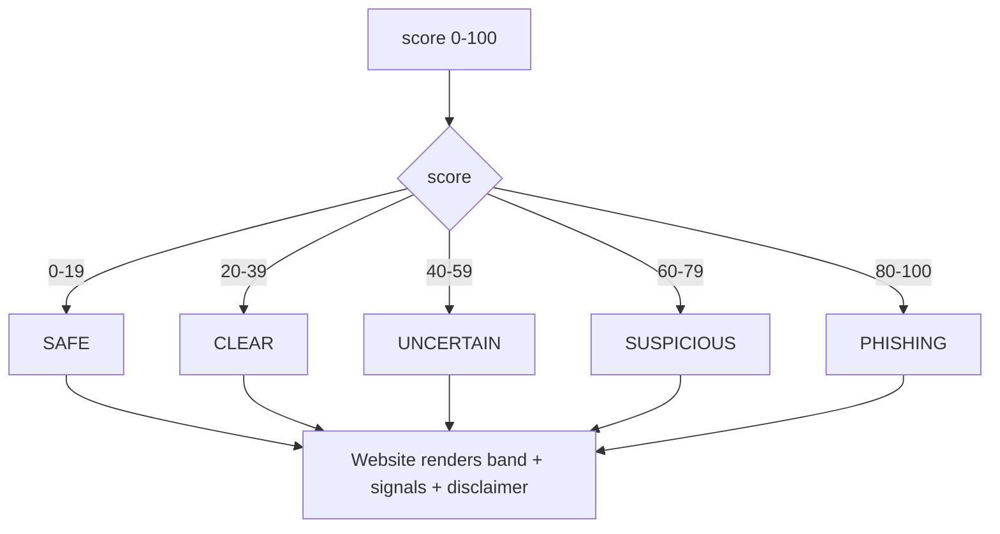
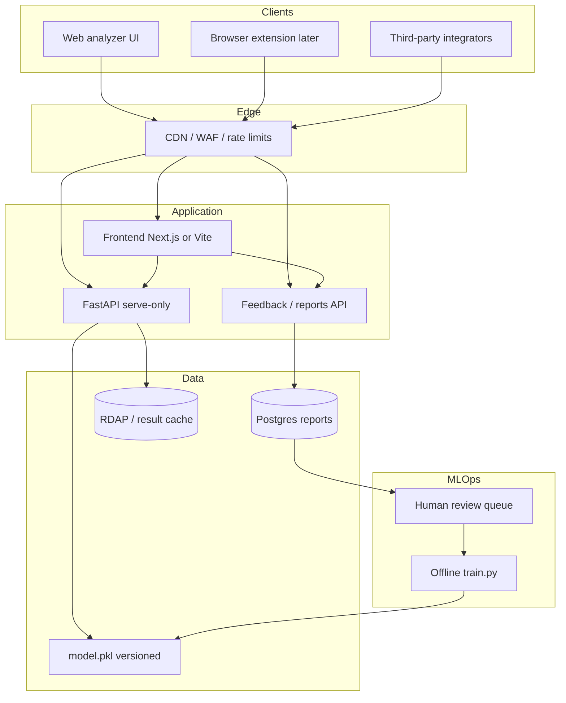
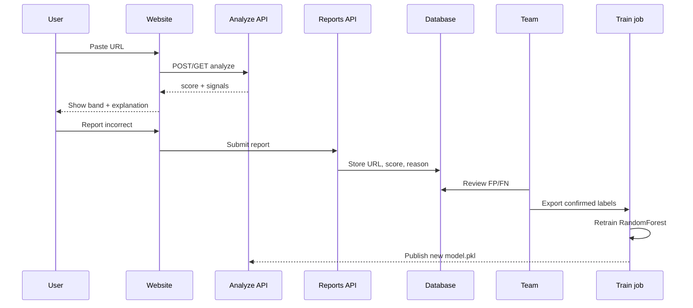
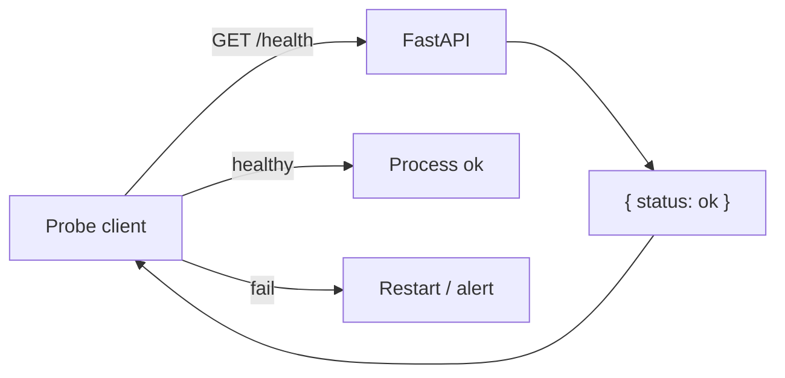

# PhishSignal — System Flowcharts

Mermaid diagrams for the as-built API/ML path and the larger phishing-detector site. Render in any Mermaid-capable viewer (GitHub, VS Code, etc.).

---

## 1. As-built request flow (`GET /analyze`)

---

## 2. As-built module boot path (important)

Today, importing `model.py` (which `api.py` does) runs training before serving.

**Product implication:** production should **load** `model.pkl` only; training belongs in an offline `train.py` job (see PRD Phase 0).

---

## 3. Feature extraction detail

---

## 4. Score → UI label mapping (frontend responsibility)

---

## 5. Target site architecture (larger product)

---

## 6. Crowdsourcing improvement loop (planned)

---

## 7. Health probe

---

## 8. Component ownership map

| Component | Owner file / layer | Exists today? |
|---|---|---|
| HTTP routes | `api.py` | Yes |
| Feature extract + analyze | `model.py` | Yes |
| Trained artifact | `model.pkl` | Yes |
| Dataset | `apidataset.csv` | Yes |
| Website UI | `web/` | Yes — Next.js analyzer |
| Reports API + DB | *(not in repo)* | No — planned |
| Offline train | `TRAIN_MODEL=1` / `train_and_save()` | Yes — optional; serve uses `model.pkl` |
